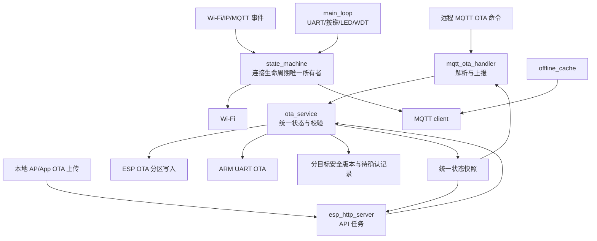

# ESP32-C2 固件稳定化与 OTA 整合设计

日期：2026-07-19
目标平台：ESP32-C2，4 MiB Flash，ESP-IDF 5.5.x
改造范围：`esp32c2_idf/`；Arduino 版本只作为协议和行为参考，不在本轮同步重构。

## 1. 目标

本轮改造在保留现有产品能力的前提下，修复已确认的稳定性和安全问题，并降低后续维护成本。

需要保留的能力：

- Wi-Fi、BLE 与 AP/App 配网。
- MQTT 连接、控制、遥测与离线缓存。
- 远程 MQTT OTA。
- 本地 AP/App OTA。
- ESP32-C2 自身固件 OTA。
- 通过 UART 给 ARM 控制器升级。
- 4 MiB 分区布局。

需要删除的能力：

- AP 首页、状态页、OTA 页面及其 HTML、CSS、JavaScript。
- 面向浏览器的跳转、表单和页面兼容代码。

本轮不做：

- 不重写 MQTT 业务协议。
- 不改变 ARM UART OTA 帧协议。
- 不重构 Arduino 版本。
- 不增加逐块数字签名。
- 不改变 4 MiB Flash 为 2 MiB。

## 2. 已确认的问题

### 2.1 安全与 OTA

- C2 的 `ota_signature.c` 当前直接返回成功，实际没有执行 Ed25519 验签。
- 本地 AP OTA 可在未校验发布清单时写入固件。
- MQTT、本地 AP 和旧 `ota_manager` 各自维护 OTA 流程，状态、错误码和安全策略已经分叉。
- ESP 与 ARM 共用一个安全版本号，两个目标会互相阻塞升级。
- ESP 安全版本在重启并确认新固件健康前就持久化，失败回滚后可能无法重试。
- ESP-IDF 回滚功能未启用，文档描述的启动健康确认没有落地。
- 本地 `/ota/progress` 返回固定内容，App 无法获取真实进度。

### 2.2 连接状态机

- Wi-Fi 短暂断开会销毁 MQTT client；Wi-Fi 恢复后只调用 connect，不会重新 init，MQTT 可能永久离线。
- 设备运行中写入 MQTT key 后，不会重建 MQTT client。
- Wi-Fi 和 IP 事件只按数值 `event_id` 分支，没有先判断事件基类。两个事件域都存在值为 0 的事件，可能误判并错误转换事件数据。
- MQTT 生命周期状态由多个任务读写，缺少单一所有者。

### 2.3 实时性与任务模型

- `tcp_provision_process()` 在主循环和状态机内重复调用。
- 旧 socket 服务器每次 `select` 最多阻塞 100 ms，主循环正常情况下可能累计阻塞约 200 ms。
- 115200 波特率下，1 KiB UART 接收缓冲约 89 ms 就可能填满，存在丢包风险。
- 本地 OTA 上传在主任务内长时间阻塞，可能触发任务看门狗。

### 2.4 存储与离线缓存

- 多个 NVS setter 忽略写入或 commit 失败，调用端仍返回成功。
- 离线缓存声明为批量落盘，当前却几乎每条消息都单独写文件，增加 SPIFFS 磨损。
- 离线消息在 MQTT publish 进入发送队列后立即删除，没有等待 PUBACK，断线窗口可能丢数据。
- 文件扫描、读取和网络发送期间长时间持有互斥锁。
- 损坏缓存文件缺少明确隔离和统计。

## 3. 方案选择

采用定向整合，不做整仓重写。

原因：当前协议、UART 和 ARM OTA 已有大量业务逻辑。直接重写风险过高；只打补丁又会继续保留三个 OTA 实现和两个网络状态所有者。定向整合可以先建立清晰边界，再逐项迁移现有能力。

核心原则是：

> 两个 OTA 入口，一个 OTA 内核；一个连接状态所有者；主循环不执行阻塞网络 I/O。

## 4. 总体架构



模块职责：

- `app_main`：组件初始化、事件注册、任务创建和启动健康确认。
- `state_machine`：Wi-Fi 与 MQTT 生命周期的唯一决策者。
- `mqtt_handler`：MQTT client 封装、订阅、发布和事件转发，不决定重连策略。
- `ap_api_server`：运行在独立 HTTP server 任务，提供配网和 OTA JSON API。
- `mqtt_ota_handler`：解析 MQTT OTA 命令，将命令提交给 `ota_service`，把统一状态发布到 MQTT。
- `ota_service`：唯一 OTA 状态机、发布清单校验、摘要、验签、安全版本、取消和目标写入协调器。
- `arm_ota`：只实现 UART 传输细节和 ARM ACK，不维护上层任务身份。
- `offline_cache`：持久化待确认 MQTT 消息，并根据 PUBACK 完成删除。

旧 `ota_manager.c` 的有效能力迁移完成后删除，避免第四套状态。

## 5. 连接与任务设计

### 5.1 事件处理

事件回调必须先判断 `event_base`，再解释 `event_id` 和事件数据：

- `WIFI_EVENT_STA_START`：通知状态机开始连接。
- `WIFI_EVENT_STA_DISCONNECTED`：只标记链路中断并通知状态机，不在回调中销毁 MQTT client。
- `IP_EVENT_STA_GOT_IP`：更新 IP 状态并通知状态机。
- MQTT connected/disconnected：只写入事件队列或原子状态，不从 MQTT 回调直接驱动 Wi-Fi。

### 5.2 MQTT 生命周期

状态机区分两类动作：

- 临时断线：保留 client，由 ESP-MQTT 自动重连或在网络恢复后调用 start/reconnect。
- 配置变化：SN、key、broker 或凭据改变时，受控地 stop、destroy、init、start。

当设备首次没有 key 时，`mqtt_init` 可以返回“配置未就绪”。收到并成功持久化 key 后，状态机必须触发完整初始化。

### 5.3 主循环

主循环只执行有界、非阻塞工作：

- UART 收发与协议推进。
- 按键和 LED 状态推进。
- 状态机 tick。
- 看门狗复位。

HTTP、固件下载、Flash 写入和 ARM 升级均在独立任务执行。目标主循环周期不超过 10 ms，任何一次同步调用不得等待网络超时。

## 6. AP/App API

AP 继续用于 App 配网和本地 OTA，但不再提供网页。

保留或新增的 API：

| 方法 | 路径 | 用途 |
| --- | --- | --- |
| `GET` | `/scan` | 启动或读取 Wi-Fi 扫描结果 |
| `POST` | `/config` | 写入 Wi-Fi SSID 和密码 |
| `GET` | `/wifi_status` | 查询配网和连接结果 |
| `GET` | `/ota/info` | 查询设备版本、目标和容量 |
| `GET` | `/ota/progress` | 查询统一 OTA 状态快照 |
| `POST` | `/ota/upload` | App 直接上传 ESP 或 ARM 固件 |
| `POST` | `/ota/cancel` | 请求取消当前可取消的 OTA |

以下路由删除并统一返回 JSON `404`：

- `/`
- `/index.html`
- `/status`
- `/ota`
- 页面静态资源和浏览器跳转路由

### 6.1 配网兼容

`POST /config` 首选 `application/json`：

```json
{
  "ssid": "HomeWiFi",
  "password": "example-password"
}
```

为避免旧 App 立即失效，本轮保留现有 URL encoded 请求解析。两种格式最终调用同一个校验和 NVS 写入函数。只有 NVS commit 成功后才返回成功。

### 6.2 本地 OTA 上传

`POST /ota/upload` 使用原始 `application/octet-stream` body，避免 multipart 全量缓存和重复解析。发布清单放在请求头：

| 请求头 | 约束 |
| --- | --- |
| `X-OTA-Task-Id` | 1-63 字符；App 生成 |
| `X-OTA-Target` | `esp` 或 `arm` |
| `X-OTA-Version` | 1-31 个可打印 ASCII 字符 |
| `X-OTA-Size` | 正整数，且等于 `Content-Length` |
| `X-OTA-SHA256` | 64 个小写十六进制字符 |
| `X-OTA-Security-Version` | 正 `uint32`，必须大于目标已确认版本 |
| `X-OTA-Signature` | RFC 4648 标准 Base64 Ed25519 签名 |

服务端在读取 body 前完成字段、容量、安全版本和一次 Ed25519 签名校验。签名只证明发布清单；接收 body 时使用 4 KiB 缓冲流式计算 SHA-256。最终摘要不匹配时废弃写入，不激活新固件。

签名消息沿用 `OTA_Ed25519_Signing_V1.md` 的规范化文本：

```text
CS_INV_OTA_V1
target=<target>
version=<version>
size=<size>
sha256=<sha256>
security_version=<security_version>
```

不会逐块验签，也不会给每个数据块增加签名。一次升级只执行一次 Ed25519 验签和一次流式 SHA-256。

成功响应：

- ESP：写入、摘要校验和 `esp_ota_end` 成功后返回 `200`，状态进入 `rebooting`，随后重启。
- ARM：请求被 worker 接受时返回 `202`；App 通过 `/ota/progress` 观察 ARM 传输和 ACK 结果。

## 7. 远程 MQTT OTA

远程 OTA 保留现有主题：

- 命令：`cs_inv/{sn}/ota/cmd`
- 状态：`cs_inv/{sn}/ota/status`
- 错误：`cs_inv/{sn}/ota/error`

`start` 命令继续包含 `task_id`、`target`、`version`、HTTPS `url`、`file_size`、`sha256`、`security_version`、`signature` 和 `timeout`。

远程流程：

1. MQTT handler 解析命令并构造发布清单。
2. `ota_service` 在启动下载前完成字段、安全版本和一次 Ed25519 验签。
3. worker 使用 `esp_http_client` 和证书包下载，只允许 HTTPS。
4. worker 使用 4 KiB 缓冲边下载边写目标，并流式计算 SHA-256。
5. 完成后比较文件长度和摘要，再完成 ESP 分区或 ARM UART 安装。ARM 镜像先暂存到 `/cache/arm_ota.bin`；摘要通过后才发送 `CMD_ARM_OTA_START`。
6. 状态变化由 observer 通过 MQTT 上报。

`timeout` 范围为 60-3600 秒，应用于整次下载/接收活动超时，不再使用写死的 ESP 300 秒和 ARM 600 秒。

MQTT 查询或取消命令不会覆盖当前 worker 的 `task_id`。每个请求的上报上下文独立保存，避免并发查询导致进度串单。

## 8. 统一 OTA 内核

### 8.1 单任务约束

全设备同一时刻只允许一个 OTA。无论远程或本地，第二个 `start` 都返回 `OTA_BUSY`，并保留当前任务。

### 8.2 状态

统一状态机：

```text
idle -> accepted -> downloading/receiving -> verifying -> installing
     -> rebooting                  (ESP)
     -> succeeded                  (ARM)

任一允许阶段 -> cancelling -> cancelled
任一失败阶段 -> failed
ESP 新固件启动失败 -> rolled_back
```

状态快照包含：

```json
{
  "task_id": "ota-20260719-001",
  "source": "mqtt",
  "target": "esp",
  "state": "downloading",
  "progress": 42,
  "received": 524288,
  "total": 1237232,
  "version": "1.0.27",
  "error_code": "",
  "message": ""
}
```

快照由互斥锁保护，读取时复制后立即释放锁。网络发布和 HTTP 发送不能在持锁状态执行。

### 8.3 取消

下载、接收和 ARM 传输阶段可取消。ESP 已完成 `esp_ota_set_boot_partition` 后不接受取消，并返回 `OTA_NOT_CANCELLABLE`。

本地 HTTP 连接中断视为本地接收取消；远程 MQTT 使用现有 `cancel` action。取消后必须调用对应目标的 abort/清理函数。

### 8.4 资源约束

- OTA 数据缓冲：4 KiB，共用，不为两个入口重复分配。
- HTTP server stack：以 4 KiB 为起点，结合 high-water mark 调整。
- 不把完整 ESP 或 ARM 固件加载进 RAM。
- ARM 镜像沿用 cache 分区临时文件暂存。OTA 前检查空间；失败或取消后必须删除临时文件。暂存期间离线缓存不得抢占其保留空间。
- 4 MiB 分区表保持双 OTA slot 与 cache 分区。
- 编译后必须检查静态 RAM、任务栈和 OTA slot 余量。

## 9. 签名与安全版本

### 9.1 Ed25519

C2 必须执行真实 Ed25519 验签。优先使用 ESP-IDF 自带 Mbed TLS/PSA Crypto 的 PureEdDSA 支持；若目标配置不能提供该能力，再引入小型、经过验证的 Ed25519 组件。

验签实现必须通过固定测试向量：

- 正确清单和签名成功。
- 修改 target、version、size、SHA 或 security_version 任一字段后失败。
- 非法 Base64、错误长度和非规范 SHA 失败。

公钥继续编译进只读固件。私钥只存在于发布工具和受控发布环境，不能进入固件仓库。

### 9.2 分目标防降级

NVS 分开保存：

- `ota_sec_esp`：已确认健康的 ESP 安全版本。
- `ota_sec_arm`：ARM 明确返回成功 ACK 的安全版本。
- `ota_pending_esp`：已写入并准备启动、但尚未确认健康的 ESP 安全版本及任务元数据。

ESP 流程：

1. 写入非活动分区并校验摘要。
2. 写 `ota_pending_esp`，设置启动分区并重启。
3. 新固件启动后执行最小健康检查：NVS、UART 任务、Wi-Fi 状态机和主循环看门狗均正常。健康检查只要求网络状态机可运行，不要求现场 Wi-Fi 或 MQTT broker 实际可达。
4. 在 60 秒确认窗口内满足条件后，调用 `esp_ota_mark_app_valid_cancel_rollback()`。
5. 之后才把 pending 安全版本提升为 `ota_sec_esp` 并清除 pending。pending 同时保存 task ID、来源和目标分区，以便重连后补报 `succeeded` 或 `rolled_back`。
6. 启动失败由 bootloader 回滚；旧固件发现 pending 不对应当前运行分区时，记录 `rolled_back` 并清除 pending，不提升安全版本。

ARM 只有在完整镜像摘要通过、UART 传输完成且 ARM 返回最终成功 ACK 后，才提升 `ota_sec_arm`。

## 10. 离线缓存

离线缓存继续使用现有 SPIFFS cache 分区，不迁移数据库格式。

改造规则：

- RAM 中累积最多 10 条或 60 秒后批量落盘；断网、低内存和关机前允许立即刷盘。
- 文件写入采用临时文件加原子 rename，避免掉电留下半文件。
- publish 成功只表示已入 MQTT 发送队列。QoS 1 消息必须等对应 PUBACK 后才能从磁盘删除。
- 每次只取一小批索引，在锁外发布；ACK 回调再短暂持锁更新确认状态。
- 损坏文件移动到隔离命名或删除，并增加错误计数，不能悄悄当作成功发送。
- 达到容量上限时按最旧顺序淘汰，并记录淘汰数量。
- `last_sync_time` 的读写使用同一互斥策略。

如果 broker 重复接收同一 QoS 1 消息，云端应依据消息 ID/时间戳去重；本地优先保证不丢失。

## 11. 错误处理

内部错误统一映射为稳定错误码，两个入口使用相同含义：

| 错误码 | 含义 |
| --- | --- |
| `INVALID_PARAMS` | 清单字段缺失或格式错误 |
| `INVALID_TARGET` | 目标不是 `esp` 或 `arm` |
| `TLS_REQUIRED` | 远程 URL 不是 HTTPS |
| `SIGNATURE_REQUIRED` | 缺少签名 |
| `SIGNATURE_INVALID` | Ed25519 验签失败 |
| `ROLLBACK_REJECTED` | 安全版本不高于已确认版本 |
| `OTA_BUSY` | 已有 OTA 正在执行 |
| `FILE_TOO_LARGE` | 超过目标容量 |
| `SIZE_MISMATCH` | 实际长度与清单不一致 |
| `HASH_MISMATCH` | SHA-256 不一致 |
| `HTTP_ERROR` | 远程下载失败 |
| `FLASH_WRITE_FAILED` | ESP OTA 写入失败 |
| `ARM_TRANSFER_FAILED` | ARM UART 升级失败 |
| `PERSIST_FAILED` | NVS 状态持久化失败 |
| `OTA_NOT_CANCELLABLE` | 已进入不可取消阶段 |

HTTP 使用合适状态码并返回 JSON；MQTT 发布到现有 status/error 主题。日志可以包含底层错误，但协议错误码保持稳定。

## 12. 测试与验收

### 12.1 自动化测试

先写失败测试，再实现代码：

- 发布清单规范化和 Ed25519 固定向量。
- 缺字段、大小溢出、非法 SHA、非法 Base64 和安全版本回退。
- OTA 状态转换、单任务互斥、取消边界和 task_id 隔离。
- AP 路由契约：页面路由不存在，App API 存在，进度来自真实快照。
- Wi-Fi 与 IP event base 分流。
- MQTT 在 Wi-Fi 临时掉线后恢复；key 写入后完成 init。
- NVS 写入失败必须向调用端传播。
- 离线批量、PUBACK 后删除、断线重发和损坏文件处理。

### 12.2 构建验证

- ESP32-C2 ESP-IDF clean build。
- 检查最终 binary 小于每个 `0x1c0000` OTA slot。
- 检查静态 RAM、OTA buffer 和新增任务 stack。
- 运行现有 Node OTA/固件契约测试。
- 删除旧实现后用链接和 `rg` 确认没有悬空入口。

### 12.3 板级验收

在真机上至少执行：

1. Wi-Fi 断开再恢复，MQTT 自动恢复订阅与上报。
2. 空 key 启动后通过 App/BLE 写 key，MQTT 无需重启即可上线。
3. App AP 配网成功，所有页面路由返回 JSON 404。
4. MQTT ESP OTA 成功、错误签名拒绝、错误 SHA 拒绝、旧安全版本拒绝。
5. App 本地 ESP OTA 执行相同四类测试。
6. MQTT ARM OTA 与 App 本地 ARM OTA 均完成最终 ACK。
7. MQTT OTA 进行时本地入口返回 `OTA_BUSY`，反向亦然。
8. ESP 新固件故意不完成健康确认，bootloader 自动回滚且安全版本不提升。
9. OTA 期间持续 UART 压测，确认无丢包和任务看门狗复位。
10. 离线积累、重启、联网发送和中途再次断线，确认消息不丢失。

没有连接真机时，只能声明“构建与主机测试通过”，不能声明板级问题已经验证。

## 13. 迁移顺序

1. 建立纯数据的 OTA manifest、状态与测试。
2. 实现真实 Ed25519 验签和分目标安全版本。
3. 建立 `ota_service`，先迁移远程 MQTT OTA。
4. 用 `esp_http_server` 建立 AP/App API，再迁移本地 OTA。
5. 启用 ESP rollback 和启动健康确认。
6. 删除页面与旧 socket HTTP 实现，删除旧 `ota_manager`。
7. 修复连接事件、MQTT 生命周期和 NVS 错误传播。
8. 修复离线缓存批量与 PUBACK 语义。
9. 完整构建、静态检查和可用时的板级验收。

每一步都保持可编译，并在进入下一步前运行相关测试。
